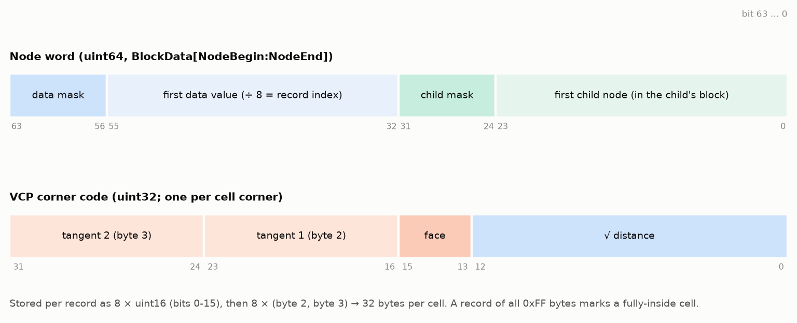
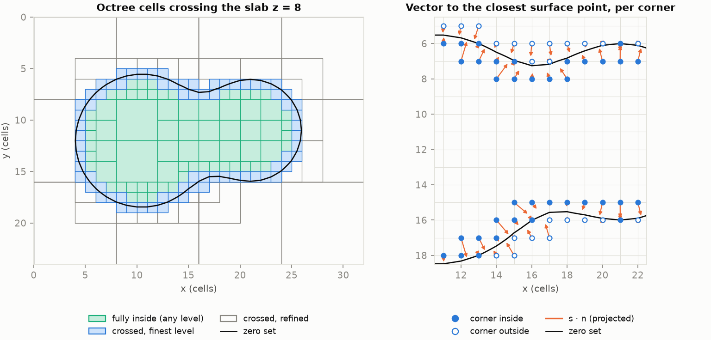
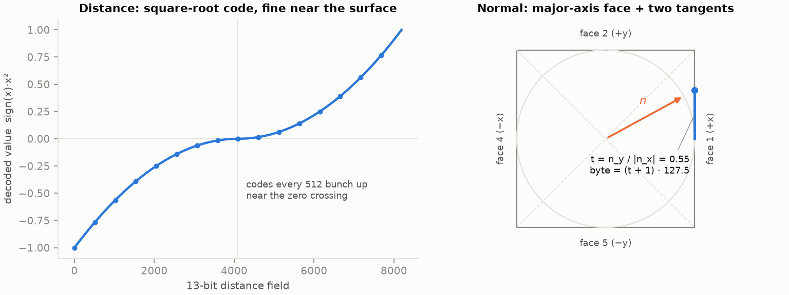
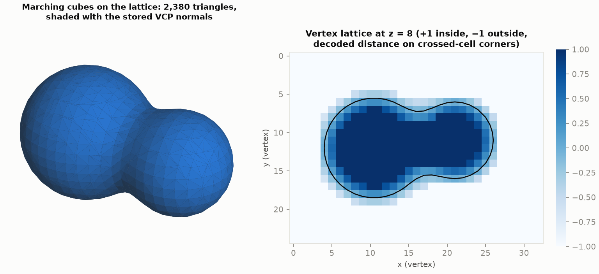

# Imaris Surfaces: the MegaSurfaces format

Imaris (version 9 and later) does not store Surfaces objects as triangle
meshes. Each object is a **sparse octree of Vector-to-Closest-Point (VCP)
samples**, the representation of Demir & Westermann (2015), which Oxford
Instruments cites for its large-image surface renderer. Nothing about the
layout is documented, so this page writes down what we reverse-engineered,
why we believe it, and what is still unknown.

The short version:

- Each object lives on a regular grid of cells. Only cells **crossed by the
  surface** store data: 8 corner codes of 32 bits each. Cells entirely inside
  are flagged in the octree; everything else is outside.
- A corner code packs a **signed distance** (square-root encoded) and an
  **outward normal** (a cube face plus two tangents).
- The surface is the **marching-cubes zero set** of the vertex lattice: decoded
  distances on crossed-cell corners, +1 inside, −1 outside. Decoding this way
  reproduces Imaris' own triangle counts, surface areas and volumes exactly.

pyvistra's decoder is `pyvistra/readers/imaris_surfaces.py`. The figures on this
page are made from a synthetic shape encoded and decoded with it
(`docs/imaris-surfaces/make_figures.py`).

## Where it lives in the file

Surfaces items are HDF5 groups `Scene8/Content/MegaSurfacesN`. The item's name
is in the group's `Name` attribute (`Scene/Content/MegaSurfacesN` only
repeats the item `Id`). One item holds every object at every timepoint:

| Dataset | Contents |
|---|---|
| `SurfaceModel` | One row per object per timepoint: `ID_Time`, `ID`, `NumberOfLevels`, grid `SizeX/Y/Z` (cells), `ExtendMin/Max X/Y/Z` (µm), `DataCountPerChildNode` (always 8), `Threshold`, and `[Begin, End)` ranges into `LevelInfo` and `BlockInfo` |
| `LevelInfo` | Per octree level: `SamplingX/Y/Z`, the split factor of a node along each axis (2, or 1 once an axis is fully resolved) |
| `BlockInfo` | The octree's blocks: `ParentBlockIndex`, `SplitOffsetsBegin/End`, `NodeBegin/End`, `LeafBegin/End`, `RelativeBlockPathBegin/End` |
| `SplitOffset`, `BlockPath` | Tables indexed by `BlockInfo` (see [Blocks](#blocks)) |
| `BlockData` | int64 words in rows of 131072; one flat word array for all models of the item |
| `SurfaceModelInfo` | Per-object statistics computed by Imaris: `Volume`, `Area`, `NumberOfTriangles`, `NodeAndDataBytes`, centroid, ellipsoid axes, ... |
| `Track0`, `TrackObject0`, `TrackEdge0` | Tracks as lists of object `ID`s |
| `StatisticsType`, `StatisticsValue`, ... | Imaris' full statistics tables (not wrapped yet) |

## Grid and octree

An object's grid has `Size` cells along each axis, with spacing
`(ExtendMax − ExtendMin) / Size`. **Lattice vertex `k` sits at
`ExtendMin + k · spacing`.** For surfaces Imaris computed from an image, the
spacing is a binned voxel size (4 × 4 × 1 in one of our datasets) and the
vertices fall on binned-voxel centers.

The octree root covers `∏ SamplingX/Y/Z` cells per axis (the grid size rounded
up to the split pattern). Each level splits its nodes by that level's
`LevelInfo` row, and the last level's cells are single grid cells. Children
and cell corners share one numbering: **`c` has x in bit 0, y in bit 1 and z
in bit 2.**



Every node is one 64-bit word:

- **child mask** (bits 24–31) flags children that are nodes of the next level.
  Child `c` is node `first child + popcount(child mask & ((1 << c) − 1))` of
  the next level's block.
- **data mask** (bits 56–63) flags children that have a 32-byte record in this
  block's leaves (`BlockData[LeafBegin:LeafEnd]`). The data offset counts corner
  values, so the record index is `first data / 8 + popcount(data mask below c)`.

Each child is in one of three states:

| Child has | Meaning |
|---|---|
| no record | entirely **outside** (empty) |
| a record of all `0xFF` bytes | entirely **inside**, a leaf |
| any other record | **crossed** by the surface: refined further, or at the finest level, a cell that holds the surface |



## Blocks

A level that grows large is split into several **blocks**, apparently so
Imaris can stream and cache parts of a surface independently. The blocks of
one object form a tree:

- `ParentBlockIndex` names the parent block (indices are relative to the
  object's `BlockInfoBegin`; the root block names itself, 0).
- A parent's `SplitOffset[SplitOffsetsBegin:SplitOffsetsEnd]` holds
  **cumulative end indices into the parent's node list**. Parent nodes in the
  `k`-th range keep their children in the parent's `k`-th child block, listed
  in `BlockInfo` order. **Child offsets restart at 0 in each child block.**
- `RelativeBlockPath` points into `BlockPath`, giving each child block a short
  bucket path such as `[4, 3]`. The paths are sorted like the blocks, and
  decoding does not need them.
- `NodeBegin/End` and `LeafBegin/End` index the flattened `BlockData`. Blocks
  of different objects interleave, and a block may start at a row boundary.

Small objects have one block per level, so each split-offset list is a single
entry equal to the parent's node count.

## VCP corner codes

A crossed cell's record is 8 × uint16 (the low halves of the 8 corner codes),
then 8 × (byte 2, byte 3). Each corner code is a 32-bit word:

- **Distance, bits 0–12.** `x = (field − 4095.5) / 4095.5 ∈ [−1, 1]`, and the
  stored distance is `sign(x) · x²`, **positive inside**. This is the square-root
  code of Demir & Westermann (`r ← √r`): resolution is finest near the
  surface, where it matters. Its physical scale, a per-object radius, is
  not stored anywhere we could find. Reconstruction doesn't need it, because
  the surface is the zero set.
- **Normal, bits 13–31.** Bits 13–15 hold the cube face of the outward normal's
  largest component: faces 1, 2, 3 are +x, +y, +z, and 4, 5, 6 are −x, −y, −z. Bytes 2
  and 3 hold the other two components divided by the largest one, mapped from
  [−1, 1] to [0, 255]. For major axis `a` (x = 0), byte 2 is axis `(a + 1) % 3`
  and byte 3 is axis `(a + 2) % 3`.

Adjacent cells repeat the codes of the corners they share, and the copies are
identical. That consistency is how the corner order was pinned down.



## Reconstructing the surface

Imaris' surface is recovered from three pieces:

1. Build the **vertex lattice** (`Size + 1` vertices per axis). Corners of
   crossed finest-level cells get their decoded distance, corners of
   fully-inside cells (at any level) get +1, and all other vertices get −1.
2. **Mesh:** run marching cubes at level 0. This matches Imaris'
   `NumberOfTriangles`, `Area` and `Volume`. Shade with the stored normals,
   interpolated along each mesh vertex's lattice edge.
3. **Inside test / mask:** interpolate the lattice trilinearly and test `> 0`.



Crossed cells on coarser levels are Imaris' level-of-detail records. Their
normals agree with the finest level at shared vertices (mean dot product
mostly 0.92–0.98, down to 0.68 for small objects), but anywhere from a few
percent to 88 % of their corner distances are exactly zero (code 4096). They are shading hints
for distant rendering, not a coarser surface. Geometry should come from the
finest level only.

## How we know

**Mesh statistics.** Marching cubes on the decoded lattice was compared with
the `SurfaceModelInfo` values Imaris stores for each object (ratios are ours
divided by Imaris'):

| Dataset | Objects | Triangles | Area | Volume |
|---|---|---|---|---|
| In-house time-lapse (13 Surfaces items, 4 × 4 × 1 binning) | 160 | identical in all | 1.0000 (≤ 0.07 % off) | 1.0000 (tiny objects ≤ 6 % off) |
| Imaris demo `PlantCell` (997,672 triangles) | 1 | identical | 1.0000 | 1.0000 |
| Imaris demo `PtK2Cell` | 15 | identical in all | 1.0000 | 1.0000 (≤ 1.6 %) |
| Imaris demo `retina` (multi-block) | 3 | ≤ 4 triangles off | 1.0000 | 1.0000 |
| Imaris demo `DrosophilaEggChamber` | 31 | ≤ 0.2 % off | ≤ 0.25 % off | ≤ 0.5 % off |
| Imaris demo `Microglia-vasculature` (43 blocks, 9 levels) | 20 | identical except one object (+4 %) | ≤ 0.25 % off | ≤ 0.7 % off |

The triangle differences are probably marching-cubes ambiguity resolution
(Imaris' variant vs scikit-image's): they leave areas and volumes within the
same small margin.

**The distance code.** Only `sign(x) · x²` reproduces the statistics. Mesh
area relative to Imaris' value, by decoding rule:

| Decoded distance | In-house | PlantCell | PtK2Cell | Microglia |
|---|---|---|---|---|
| `sign(x) · x²` | **1.0000** | **1.0000** | **1.0000** | **1.0000** |
| `x` (linear) | 1.022 | 1.024 | 1.009 | 1.005 |
| `x³` | 1.003 | 1.017 | 1.009 | 1.008 |

**The reconstruction rule.** The paper interpolates VCPs by intersecting the
tangent planes of the 8 corners. With any fixed radius, that inflates volumes
by 1–90 % on these datasets, while trilinear interpolation of the distance
matches. Imaris uses the vectors for normals, not for the geometry.

**Masks.** Imaris can export a Surface as a mask channel. Against two such
exports, pyvistra's trilinear mask with `coverage=0.25` gives Dice 0.990,
with voxel counts within 1.2 %. Imaris includes voxels that are partly inside the
surface: the voxel-center rule gives 0.965, and the ≥ 50 % coverage rule 0.972.

## Unknowns

- **`Threshold`** (0.50006 in every file we've seen) plays no role in decoding.
- **The distance radius:** the physical scale of a decoded distance isn't
  stored, and fits vary from object to object. Reconstruction is scale-free,
  so this only matters for anyone who wants µm distances off the surface.
- **Coarse-level distances:** see above. Normals are usable; distances often
  aren't.
- **`BlockPath`**: the bucket paths are consistent with the block order, but
  their meaning (a spatial split code?) isn't confirmed.
- **Writing files Imaris can open** is untested. The tests write the tables
  above and read them back, but Imaris may expect more, such as the statistics
  tables and scene XML.

## Using it from pyvistra

```python
from pyvistra.readers import ImarisReader

r = ImarisReader("embryo.ims")
r.surfaces                      # {"AB": <ImarisSurfaces 'AB': 1 objects, t=0..0>, ...}
cells = r.surfaces["ABa"]
cells.object_ids, cells.time_indices, cells.statistics["Volume"], cells.tracks

mask = cells.mask(t=7)              # bool (Z, Y, X) on the image grid
labels = cells.labels(t=7)          # uint32, object ID + 1, 0 outside
imaris_like = cells.mask(t=7, coverage=0.25)   # match Imaris' mask export
mesh = cells.mesh(cells.indices_at(7)[0])      # vertices in voxel coords (Z, Y, X)

octree = cells.octree(0)            # SurfaceOctree: physical µm, levels, raw codes
octree.lattice, octree.mesh(), octree.sample(points_um)
```

Mesh vertices are in voxel-index coordinates of the chosen resolution level,
with voxel centers at integers, so scaling by `voxel_size` places a mesh over
the image the same way pyvistra places the volume.

A local-background shell, for example the 2 µm outside one cell and away
from every other cell:

```python
from scipy.ndimage import distance_transform_edt

d = distance_transform_edt(labels != id_ + 1, sampling=r.voxel_size)
shell = (d > 0) & (d <= 2.0) & (labels == 0)
background = r.read(c=1, t=7)[shell].mean()
```

## Adopting the encoding in pyvistra

The reason to borrow this representation isn't raw size. Imaris' layout stores
every crossed cell's 8 corners separately, about 4× redundant, so it ends up
about as large as a float32 mesh:

| Object | Grid (cells) | Imaris octree | float32 mesh | Codes, one per band vertex |
|---|---|---|---|---|
| PlantCell | 38 × 303 × 467 | 32.6 MB | 23.9 MB | 4.0 MB |
| Microglia vasculature | 231 × 257 × 257 | 13.8 MB | 12.5 MB | 2.0 MB |

What it does buy:

- **Band-only, implicit storage.** One 32-bit code per surface vertex, plus
  octree flags for "inside", describes the surface fully. Inside/outside and
  distance queries are O(1) lattice lookups, and the exact mesh comes back on
  demand.
- **Streaming and level of detail.** Blocks are independent subtrees. Coarse
  crossed cells carry normals, so a renderer can draw distant blocks as
  oriented splats and mesh only nearby blocks.
- **Ray casting** of the band directly on the GPU (the paper's use), with
  normals for shading and no mesh at all.

A pyvistra-native variant could keep the octree and codes but store each band
vertex once: about 7–8× smaller than Imaris' layout and 6× smaller than the
mesh, before the octree flags. `SurfaceOctree.from_signed_distance` already encodes any signed-distance
lattice (for example one computed from a label image with an EDT), and
`SurfaceOctree.mesh` turns any octree back into a mesh.

## References

- I. Demir, R. Westermann. *Vector-to-Closest-Point Octree for Surface
  Ray-Casting.* Vision, Modeling & Visualization 2015, 65–72.
  [doi:10.2312/vmv.20151259](https://diglib.eg.org/handle/10.2312/vmv20151259)
- Oxford Instruments. *Imaris 9 surfaces rendering technology for large
  images.*
  [oxinst.com](https://www.oxinst.com/learning/view/article/imaris-9-surfaces-rendering-technology-for-large-images)
- S. F. F. Gibson. *Using distance maps for accurate surface representation in
  sampled volumes.* IEEE Symposium on Volume Visualization 1998, 23–30.
